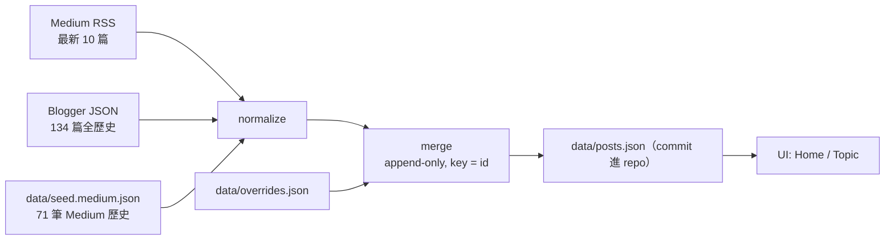

# Outline — 自動化文章索引站設計

- 日期：2026-08-29
- 狀態：待審閱
- 定位：architectural（資料模型、路由、部署皆變動）

## 1. 目標

把 `outline` 從「手工維護的連結清單」改成「由 feed 驅動的文章索引站」。

- 單一入口，聚合 Medium（技術／演算法）與 Blogger（旅遊）兩個來源。
- **零人工貼連結**：新文章發佈後由排程自動出現。
- 分類、標籤、日期、縮圖全部從來源 metadata 推導。
- 首頁回答「他最近寫了什麼」；分類頁可分享、可收藏。

## 2. 非目標

- 不托管內容。文章正本永遠留在 Medium／Blogger，本站只導流。
- 不做 SSR／SSG。純 SPA，SEO 紅利留在平台端，這是選定路線的必然結果。
- 不做後端、資料庫、CMS、後台管理。
- 不產生 `sitemap.xml` 與 `rss.xml`。SPA 沒有 SSR，sitemap 對爬蟲無效；索引站的 RSS 目前無需求。保留 OG／description（社群分享有實質效果）。
- 不重構未被本次變動觸及的元件。

## 3. 現況問題（證據）

| 問題 | 證據 |
| --- | --- |
| 索引已經在漏 | Blogger 有 134 篇，`travelConfig.ts` 只列 55 篇 → **79 篇從未被索引**；Medium 最新 10 篇**全部**不在索引內（5 篇「AI 學習筆記」、QuadTree、4 篇 LeetCode） |
| 資料模型分裂 | `techConfig.ts` / `algoConfig.ts` / `travelConfig.ts` 三種形狀；domain 綁在頁面：`Travel.tsx:46` 寫死 `bloggerDomain`、`Algorithm.tsx:27` 寫死 `mediumDomain` |
| 單一分類假設不成立 | `/p/5bc7be208eac`（11. Container With Most Water）同時出現在 `algoConfig.ts:73` 與 `:95`，72 筆條目只有 71 個唯一 id |
| metadata 只有標題與連結 | `List.tsx:3-6`。無日期 → 無法排序、無法做「最新」 |
| 子分類無法分享 | 選單狀態只在 `useState`（`Travel.tsx:17`、`Algorithm.tsx:11`），「日本住宿」沒有自己的 URL |
| 外連 utm 會弄壞帶 query 的連結 | `List.tsx:37` 字串拼接 `?utm_source=` |
| 分享出去沒有預覽 | `index.html` 無 description／OG；favicon 指向 GitHub CDN（`index.html:10`） |
| 文件與現實不符 | `README.md:19` 宣稱 SEO optimized（實際 HashRouter SPA）、`README.md:28` 宣稱 Vercel（實際 `package.json` gh-pages） |

## 4. Feed 實測結果（2026-08-29 實際抓取）

### Medium：`https://medium.com/feed/@sean1093`

- 標題 `Stories by Sean Chou on Medium`，可匿名存取。
- 欄位：`title` / `link` / `guid` / `pubDate` / `category[]`（Medium tags）/ `content:encoded` / `dc:creator`。
- **`guid` 形如 `https://medium.com/p/<id>`**，與現有 config 的 `link: '/p/<id>'` 同構 → seed 與 feed 以 id join，無需人工對照。
- `link` 是刊物網址（`medium.com/技術筆記/...`，percent-encoded）；正規連結一律用 `https://medium.com/p/<id>`。
- **硬限制：只回最近 10 篇。** 歷史文章需 seed（見 §9）。
- 網頁端對 curl／reader 一律 403，只能靠 RSS 或真實瀏覽器。

### Blogger：`https://travel-sean.blogspot.com/feeds/posts/default?alt=json&max-results=150&start-index=N`

- 全歷史可抓：**134 篇**，但**必須分頁**。Blogger 把回應主體截在約 2.6MB，`max-results=150` 與 `max-results=500` 回傳位元組相同的內容、都只有 74 筆，且不提供 `rel="next"`。實際行為：`start-index=1` → 74 筆、`start-index=75` → 60 筆、再往後 → 0 筆。`openSearch$itemsPerPage` 會回報與實際筆數不符的值，不可用來推算數量。
- 欄位：`published` / `updated` / `category[].term`（label）/ `content` / `media$thumbnail`（134/134）/ `link[rel=alternate]` / `georss$point`（133/134）。
- **40 個 label：39 個全部是地名，加一個 `英文版本`（4 篇）。** 地名 label 的覆蓋率足以獨力支撐地點維度：
  - **130/134 篇有國家層級 label**（日本 50、台灣 44、澳洲 24、馬來西亞 11、泰國 4）。缺的 4 篇正是那 4 篇 `英文版本`，它們**只有** `英文版本` 一個 label。
  - 只有國家、沒有地點 label 的僅 3 篇，且都是本來就跨城市的總覽文（`酒吧清單`、2 篇 `台灣旅遊`）——不是漏標。
  - 跨國家文章 1 篇（`酒吧清單`，橫跨 4 國）。
  - 每個國家底下的地點數：日本 18、台灣 11、澳洲 3、馬來西亞 1、泰國 1。
- 反向檢查：現有 55 個 config 連結全部存在於 feed，0 死連結。

## 5. 架構與資料流



真相來源分層，責任不重疊：

- **來源 feed**：文章是否存在、標題、日期、tags、縮圖。
- **`seed.medium.json`**：Medium RSS 拿不到的歷史（凍結，只在 backfill 時寫）。
- **`overrides.json`**：例外修正，形狀 `Record<PostId, { topic?: Topic; addTags?: string[]; hidden?: true }>`。`hidden` 在 sync 階段就把該筆排除、不寫進 `posts.json`（因此 `Post` 不需要 `hidden` 欄位）。**已知後果（Task 7 審查發現）**：因為 `posts.json` 同時是 sync 的輸入與輸出，`hidden` 不只是隱藏，而是把該筆從累積archive中抹除——對於落在 Medium RSS 10 篇視窗外、又不在 seed 裡的文章，即使日後移除 override 也救不回來。若要用 `hidden`，先改成「寫入未過濾的 merge 結果，由 `src/lib/posts.ts` 在讀取時過濾」。預期長度接近 0；不是常態工作流，也不提供置頂功能。
- **`posts.json`**：生成物，commit 進 repo。可審、可回溯、build 不依賴網路。

`merge` 為 **append-only**：以 `id` 為 key，feed 有的覆寫欄位，feed 沒有的既有項目保留。這讓 Medium 的 10 篇上限、平台暫時性故障都不會造成資料消失，最壞情況是「停止更新」。

## 6. 資料模型

```ts
export type Source = 'medium' | 'blogger';
export type Topic = 'tech' | 'algo' | 'travel';

export interface Post {
  id: string;          // medium: 'p/<id>'；blogger: '/2021/05/slug.html'
  source: Source;
  title: string;
  url: string;         // canonical 絕對網址
  topic: Topic;
  tags: string[];      // 去重、保序
  date?: string;       // ISO 8601；缺值見 §10
  summary?: string;    // content 首段純文字，截斷 140 字
  image?: string;      // media$thumbnail 或 content 首張 img
  geo?: [number, number];  // Blogger georss，保留給未來地圖視圖，本次不渲染
  lang?: 'en';         // 只在英文版本標記；未標記即中文
}
```

- `id` 是唯一鍵，也是 dedup 依據（解掉 §3 的重複條目問題）。
- 一篇文章可帶多個 tag，取代原本「一篇只能屬於一個 category」的結構。
- 215 筆 × ~1.0KB ≈ **212KB 單一 JSON**（實測 2026-08-30：215 筆、216,935 bytes），隨 bundle 一起送（build 後 320KB JS／gzip 137KB）。不需分頁、不需搜尋服務。

## 7. 分類規則

### 7.1 `topic`

| 順序 | 條件 | 結果 |
| --- | --- | --- |
| 1 | `overrides.json` 指定 `topic` | 採用該值 |
| 2 | `source === 'blogger'` | `travel` |
| 3 | Medium 且 `tags` 含 `algorithms` / `leetcode` / `演算法` | `algo` |
| 4 | Medium 且標題含 `[LeetCode 解題紀錄]` / `演算法筆記` / `基礎演算法`（seed 沒有 tags，靠這條） | `algo` |
| 5 | 其餘 Medium | `tech` |

實測依據：feed 內 5 篇演算法類文章（QuadTree ＋ 4 篇 LeetCode）全部帶 `algorithms` tag，4 篇 LeetCode 另帶 `leetcode`；AI／LLM 系列帶 `ai`、`llm` 等，落入 `tech`。

### 7.2 `tags`

- Medium：`category[]` 原樣帶入（genai、ai-agent、react…），單一維度。
- Blogger：**兩個獨立面向（facet）**——地點（§7.3）與類型（§7.4）。兩者都存在同一個 `tags` 陣列，靠 §7.3／§7.4 的規則各自算出可選值，UI 可組合過濾。
- `英文版本` 不進 tags，轉成 `lang: 'en'`。

### 7.3 地點（完全由 Blogger label 驅動）

地名 label 已足夠支撐整個地點維度，**沒有任何從標題猜地名的機制**。規則：

| 項目 | 規則 |
| --- | --- |
| 國家層級 | 靜態清單 5 筆：`台灣`、`日本`、`泰國`、`澳洲`、`馬來西亞`。這是本設計唯一的靜態地理資料。 |
| 地點層級 | 其餘所有非 `英文版本` 的 label 一律視為地點，歸屬由**同一篇文章上的國家 label** 決定。新增城市 label 自動生效，程式無須改動。 |
| 跨國家文章 | 同時出現在每個國家底下（`酒吧清單` 橫跨 4 國，此為正確行為）。 |
| 只有國家沒有地點 | 歸在該國家的「全部」清單，不進任何地點分組（3 篇總覽文）。 |
| 4 篇 `英文版本` | 全庫唯一沒有地名 label 者。用 `overrides.json` 補 4 筆 `addTags`（`Sapporo Hotel Review` → `['日本','札幌']`、`Taipei Accommodation` → `['台灣','台北']`、`Yilan Accommodation` → `['台灣','宜蘭']`、`Sun Moon Lake Accommodation` → `['台灣','日月潭']`）。為 4 列資料寫一個英文地名 parser 不划算，而 overrides 機制本來就存在。你也可以直接去 Blogger 補這 4 篇的 label，之後把 overrides 刪掉。 |

**明確不做三層階層（國家 → 都道府縣／州 → 城市）。** label 不含包含關係，而共現無法替代：`北海道`（12 篇）與 `京都`、`仙台`、`大阪`、`小倉`、`由布院`、`福岡` 都共現過，因為跨區總覽文一次貼上多個地名。任何自動推導的階層都會把京都放進北海道底下。唯一乾淨的案例只有 `秋田 ↔ 田澤湖`，不足以撐起一套規則。兩層在實測下完全乾淨：日本 18 個地點、台灣 11、澳洲 3、馬來西亞 1、泰國 1。

### 7.4 旅遊類型（a → b → c 降級鏈）

**(a) 來源 label 優先。** Blogger label 若含類型詞（住宿／景點／酒吧／美食…）直接採用。目前 39 個地名 label 中沒有類型詞，所以此層現在不會命中；你日後在 Blogger 補類型 label，程式無須改動即生效，並自動優先於 (b)。

**(b) 標題前綴推導。** 你的 Blogger 標題有嚴格慣例 `<地區><類型> | <名稱> | …`。取 `|` 分段後的**前兩段**串接，依序比對：

| 順序 | 類型 | pattern |
| --- | --- | --- |
| 1 | 住宿 | `住宿\|飯店\|旅館\|民宿\|hotel\|accommodation\|hostel\|ryokan\|resort` |
| 2 | 酒吧 | `酒吧\|bar\b\|居酒屋\|cocktail\|speakeasy` |
| 3 | 景點 | `景點\|attraction\|park\b` |
| 4 | 美食 | `美食\|餐廳\|咖啡\|cafe\|甜點\|早餐\|restaurant` |
| 5 | 交通 | `航空\|airlines\|機場\|鐵路\|新幹線\|租車\|jr\b` |
| 6 | 行程 | `自由行\|自助旅行\|旅遊\|行程\|懶人包\|攻略\|itinerary` |

順序是演算法的一部分，不可調換：特定性由高到低，`行程` 當收尾。只掃前兩段而非全標題，避免「`台南住宿 | 台南晶英酒店 | … | 飯店 bar`」被誤判成酒吧。

**實測（以 `travelConfig.ts` 現有 55 筆人工分類為驗證集）：正確 55、誤判 0、未命中 0（100%）。**
全庫 134 篇覆蓋率 100%，分佈：住宿 49、景點 29、美食 20、行程 20、酒吧 15、交通 1。

驗證集另外證明兩件事：只掃第一段會漏 10 篇（類型詞在第二段，如 `關西自由行 | 大阪住宿 | …`）；掃全標題會誤判 1 篇。

**(c) 安全網。** 兩層都沒中 → 不給類型 tag，文章仍可透過地點 facet、搜尋、首頁最新被找到。目前資料不會落到這層，但新標題慣例改變時不會掉資料。

## 8. 站台結構與路由

| 路由 | 內容 |
| --- | --- |
| `/` | 跨來源最新 10 篇（標題／日期／來源／縮圖）＋ 三個 topic 入口（附篇數）＋ 搜尋框 |
| `/t/:topic` | 該 topic 全部文章，依 `date` 遞減；過濾列由該 topic 的資料算出（附篇數） |
| `/t/travel?place=日本` | 地點過濾。travel 的過濾列分兩段：第一段固定 5 個國家，選定後第二段展開該國的地點 chips（日本 18／台灣 11／澳洲 3／馬來西亞 1／泰國 1） |
| `/t/travel?place=京都&type=酒吧` | 地點與類型是**獨立可組合**的兩個 facet |
| `/t/tech?tag=react` | tech／algo 只有單一 tag 維度（Medium tags），沿用 `tag` 參數 |
| `/t/:topic?lang=en` | 只在 Topic 頁提供的語言切換。預設兩頁都只顯示中文；首頁「最新」永遠排除 `lang: 'en'`（那 4 篇是既有中文文章的翻譯，並列只是重複） |

`place`／`type`／`tag`／`lang` 全部存在 URL query，可分享、可收藏、可上一頁。過濾一律是 tag 比對，`place=日本` 與 `place=京都` 在資料層沒有差別——兩層只存在於呈現，資料層不做特例。

- 搜尋：前端比對 `title + tags + summary`，大小寫與全半角正規化後 `includes`。215 筆不需任何 library（實測 2026-08-30）。
- Router：`HashRouter` → `BrowserRouter`，`basename="/outline"`（對齊 `vite.config.ts:6` 的 `base`）；gh-pages 的 SPA fallback 用建置後 `cp dist/index.html dist/404.html`，不是 `public/404.html`——後者是靜態複製，拿不到 build 後的資產雜湊，不會生效。
- 外連：`new URL()` 組出 utm，取代 `List.tsx:37` 的字串拼接。
- `index.html`：補 `description`、`og:*`、`twitter:card`，換掉 GitHub CDN favicon。
- 樣式：沿用 `styles/theme.ts` ＋ `index.css` 的 CSS 變數，不引入新樣式方案。`Outline.tsx` 那一整頁 inline 裝飾隨頁面刪除而消失。

## 9. 一次性 backfill

- **Blogger：不需要。** feed 有全部 134 篇含日期、label、縮圖。`travelConfig.ts` 直接刪除。
- **Medium：71 筆。** 現有 config 提供 id 與標題，缺日期與 tags。Medium 對非瀏覽器請求 403，故 backfill 用 `browser` 工具在 `medium.com` origin 內同源 `fetch('https://medium.com/p/<id>?format=json')` 取 `latestPublishedAt` 與 tags，一次跑完 71 筆；取不到者退回讀該頁 `<meta property="article:published_time">`。
- 產出 `data/seed.medium.json` 後 commit，`scripts/backfill-medium.ts` 保留並註明為一次性工具，不進排程。

## 10. 錯誤處理與退化行為

| 情況 | 行為 |
| --- | --- |
| 任一 feed 抓取失敗／回傳非預期結構 | 不寫檔、Action 失敗（紅燈通知）、保留上一版 `posts.json` |
| feed 少了既有文章 | append-only merge 保留該文章 |
| 同一 id 出現多次 | 後者合併進前者，`tags` 聯集去重 |
| `date` 缺值 | 排在有日期者之後（同組內以標題排序）；不進首頁「最新」模組 |
| `image` 缺值 | 卡片降級為純文字列，不留破圖框 |
| 類型與地名都推導不出 | 只以 topic 呈現，仍可搜尋 |

## 11. 檔案異動清單（clean cutover）

新增：

- `scripts/sync.ts`（fetch → normalize → classify → merge → 寫檔）
- `scripts/backfill-medium.ts`（一次性）
- `.github/workflows/sync.yml`（`cron` 每日 ＋ `workflow_dispatch`；有 diff 才 commit，接著 build＋deploy gh-pages）
- `data/posts.json`、`data/seed.medium.json`、`data/overrides.json`
- `src/lib/posts.ts`（載入與推導：topics、tags、latest、search）
- `src/pages/Home.tsx`、`src/pages/Topic.tsx`
- `tsconfig.scripts.json`（型別檢查 `scripts/` 與 `tests/`；`tsconfig.app.json` 只涵蓋 `src`）
- `public/favicon.svg`
- `tests/` 與 fixtures（見 §12）
- `package.json` 新增 script：`sync`（跑 `scripts/sync.ts`）、`test`（vitest）；`predeploy` 加上 `cp dist/index.html dist/404.html`

刪除：

- `src/config/techConfig.ts`、`algoConfig.ts`、`travelConfig.ts`、`common.ts`
- `src/pages/Outline.tsx`、`Tech.tsx`、`Travel.tsx`、`Algorithm.tsx`
- `src/components/List.tsx`（由 `PostList` 取代，因為資料形狀改變）

保留並調整：

- `src/components/SubMenu.tsx` — 介面（items／activeItem／onItemClick）正好是 tag filter 需要的形狀，改由 URL searchParams 驅動而非 `useState`。
- `StickyHeader.tsx` 導覽指向新路由；`Section.tsx`、`Flex.tsx`、`Footer.tsx`、`theme.ts` 不變。
- `App.tsx` 路由改為 `/` 與 `/t/:topic`。
- `README.md` 修正部署與 SEO 描述，補 sync 流程說明。

新增依賴：

- `fast-xml-parser`（devDependency，只在 sync script 用，不進 bundle）。手刻正則解析 XML 不可接受。
- `vitest`（devDependency）。repo 目前沒有測試框架。
- `@types/node`（devDependency）。`scripts/` 用到 `node:fs`、`process`。
- **不需要 tsx／ts-node**：本機 Node 24 原生執行 `.ts`（已實測 `node main.ts` 成功），`node scripts/sync.ts` 可直接跑。代價是 Node 載入的 `.ts` 檔 import 必須帶 `.ts` 副檔名、型別匯入必須用 `import type`、不得使用 enum／namespace／parameter properties。

## 12. 測試策略

只測「會因規則錯誤而壞掉的可觀察行為」，全部針對 `scripts/sync.ts` 抽出的純函式：

1. **分類迴歸測試（最重要）**：**在刪除 `travelConfig.ts` 之前**，先把它的 55 筆人工分類抽成 `tests/fixtures/travel-type.json`（link → 住宿／景點／酒吧），斷言 `classifyTravelType` 55/55 命中且 0 誤判。日後有人動 pattern 或順序，這個測試會擋下來。實作順序因此固定：先抽 fixture ＋ 寫測試，再刪 config。
2. **normalize**：以實際抓下來的 feed fixture（各一份）斷言 Blogger entry 與 Medium item 轉出的 `Post` 欄位正確，含 `guid → id` 的推導。
3. **merge**：feed 缺少既有 id → 仍存在；同 id 重複 → 合併且 tags 聯集去重（對應 `/p/5bc7be208eac` 這個真實案例）。
4. **deriveTopic**：LeetCode／演算法標題 → `algo`；其餘 Medium → `tech`；Blogger → `travel`。
5. **地點推導**：帶 `['北海道','日本','札幌']` 的 entry → 國家 `日本`、地點含 `北海道`／`札幌`；只帶 `['台灣']` → 歸在台灣「全部」且不進任何地點分組；帶 4 個國家的 `酒吧清單` → 同時出現在 4 個國家底下；`overrides.addTags` 會與 label 聯集去重。

UI 不寫測試，改用 smoke 驗證（見 §13）。

## 13. 驗收標準

1. `yarn sync` 產出的 `data/posts.json`：唯一 id ≥ 205，其中 `source: 'blogger'` = 134、`source: 'medium'` ≥ 71。（實測 2026-08-30：215／215 唯一 id、blogger 134、medium 81）
2. Blogger 文章 100% 有 `date`、`image`、一個類型 tag；130/134 的地點直接來自 label，其餘 4 篇（`英文版本`）來自 `overrides.json`——**沒有任何一篇缺地點**。
3. `vitest` 全綠，含 55/55 類型迴歸與地點推導。
4. `yarn dev` 後以瀏覽器實際確認：首頁列出最新 10 篇且日期遞減正確；`/t/travel?place=京都&type=酒吧` 直接開啟即帶著兩個過濾狀態；點選國家後展開該國地點 chips 且篇數與 §4 實測一致（日本 18／台灣 11／澳洲 3／馬來西亞 1／泰國 1）；點擊外連帶 utm 且不破壞既有 query；搜尋「京都」同時命中 Blogger 與（若有）Medium 文章。
5. GitHub Action 手動 `workflow_dispatch` 跑一次：無新文章時不產生 commit；有新文章時 commit `data/posts.json` 並完成部署。
6. repo 內不存在 `src/config/*Config.ts` 與舊四頁；`grep` 不到 `HashRouter`。

## 14. 風險與取捨

- **平台改版**是唯一真風險（Medium 關閉 RSS、Blogger 改 feed 格式）。緩解：資料 commit 進 repo＋append-only merge，最壞是停更而非資料消失；Action 紅燈即通知。
- **Medium 只有 10 篇視窗**：每日排程對你的發文頻率有極大餘裕（同日發第 11 篇才會漏）。
- **SEO 留在平台端**：選定「索引站」路線的必然結果。因此預算放在 OG 分享卡與「最新文章」，不做 SSR。
- **類型推導依賴標題慣例**：目前 100% 準確，但慣例是你自己維持的。降級鏈的 (c) 保證慣例改變時不掉資料，只是少一個 tag；補 Blogger 類型 label 可永久脫離對標題的依賴。**地點維度完全沒有這個風險**——100% 來自 label 與 4 筆 overrides，不碰標題。

## 15. 明確排除、未來可選

- 地圖視圖（`geo` 已在 schema，133/134 有座標，本次不渲染）。
- 聚合 RSS 輸出。
- 新來源（YouTube、Substack）。schema 的 `source` 已是開放列舉，屆時只需加一個 fetcher。
- 全文搜尋（目前欄位比對對 215 筆足夠）。
